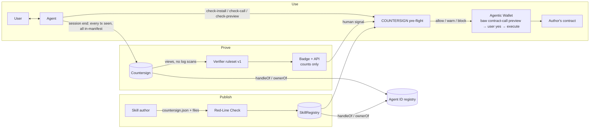

# COUNTERSIGN

### Proof-of-use trust for AI-agent skills on BNB Smart Chain

> **Download counts can be faked. The number of real Agent ID holders whose own wallets used a skill, cleanly, cannot.**

AI agents now install third-party **skills** that drive real wallets, including the Binance Agentic Wallet. The signal agents and people use to choose skills, **popularity**, is trivially faked: one researcher pushed a backdoored skill to #1 on a public skill marketplace with bot-inflated downloads ([write-up](https://dev.to/tomleelive/the-clawhub-malware-incident-a-first-warning-for-ai-agent-supply-chains-2icd)), and the Cloud Security Alliance counted over a thousand malicious skills by mid-2026 ([report](https://labs.cloudsecurityalliance.org/research/csa-research-note-ai-skill-supply-chain-attacks-20260624-csa/)).

COUNTERSIGN replaces popularity with a number bots can't inflate. For each exact skill version it shows how many **distinct Agent ID holders** made **successful, in-manifest calls to the author's own contract from their own wallet**. It then lets them **countersign** that on-chain. All of it is verified from chain data, never from opinions.

Built for the Binance Wallet × BNB Chain **Agent ID Hackathon** (Innovation Award).

---

## Votes vs. proof

| | Votes, flags, reviews | **COUNTERSIGN** |
|---|---|---|
| What a "+1" means | someone clicked | the signer's **own successful transactions** to the skill's declared contracts, cited in the countersign and re-verified from chain data |
| Can friends inflate it without using the skill? | yes | no: without in-manifest calls to the author's own contract in the 48 h before countersigning, the record is rejected |
| Can a competitor smear you? | yes, with one flag | a report is only a *claim* unless chain data proves something the reporter couldn't fake: contract drift, a pull sent by the author, or a reproducible static finding |
| Can you check it yourself? | no | `countersign status <versionId> --verify-local` recomputes every number from BSC |

## How it works



1. **Publish.** The author ships a [`countersign.json`](docs/manifest-spec.md) permission manifest inside the skill folder. It declares the contracts, functions and value caps, plus every approval and transfer with a cap; unlimited caps are rejected. The author registers the version (content hash + manifest) from their Agent ID wallet. Their own contract is the **anchor**.
2. **Use.** The user's agent runs the COUNTERSIGN companion skill next to the Agentic Wallet skill.
   - Before install: *"Registered ✓ · Countersigned by 27 · 0 verified incidents."*
   - Before every wallet call: is the target, function, value and approval inside the manifest?
   - After `baw contract-call preview`: do Binance's own simulated effects match?

   The verdict is **allow / warn / block** with plain-English reasons. The user still confirms every transaction; COUNTERSIGN never signs or sends anything.
3. **Prove.** At the end of a session the companion checks nonce accounting, so no transaction went unseen, and verifies each call against the manifest. A clean session can be **countersigned**: a zero-value transaction citing the session's tx hashes. A dirty one can be **reported**.

## Agent ID is the product

| Role of Agent ID | Without it |
|---|---|
| **Gate.** `register`, `countersign` and `report` resolve the caller's Agent ID on-chain: `handleOf(msg.sender)` → `tokenId = keccak256(handle)` → `ownerOf(tokenId) == msg.sender`. No handle or tokenId is ever passed in, so nobody can act as someone else. | anyone with a fresh wallet could inflate or smear |
| **One per version.** One countersign and one report per Agent ID per version, and each tx hash citable once per Agent ID. | the count collapses back into a gameable download counter |
| **Identity of the author.** `versionId = keccak256(contentHash, manifestHash, registrantAgentId)`, so squatting someone else's files gains nothing. | first-come registration could be hijacked |
| **Same-wallet proof.** Cited txs must come from the countersigning Agent ID wallet itself. | claims couldn't be tied to real usage |
| **Soulbound.** Standing can't be transferred or rented as a token. | reputation markets for borrowed identities |

**One-line test:** remove Agent ID and COUNTERSIGN has no product.

## Contracts (BNB Smart Chain, chain 56)

| Contract | Address | Owner / admin powers |
|---|---|---|
| `SkillRegistry` | *deploying* | **Owner:** `setAttester`, plus Ownable2Step ownership transfer and renounce. **Attester:** `attest` / `revokeAttestation`. Nothing else: no edit, delete, pause or upgrade. |
| `Countersign` | *deploying* | **None.** No owner, no admin, no upgrade, no pause. |
| Agent ID (SPACE ID `HandleRegistry`, upstream) | [`0x60B9262456dE011F7d15a54CdD8c48bAaa8B022F`](https://bscscan.com/address/0x60b9262456de011f7d15a54cdd8c48baaa8b022f) | not ours; see the [threat model](docs/threat-model.md#upstream-trust-agent-id) |

Neither COUNTERSIGN contract holds funds, accepts native value, or can touch any user's assets. The source is verified on BscScan, and the details are in [`contracts/`](contracts/).

## Use it

**As a user** (in any agent with the Binance Agentic Wallet skill):

```sh
npx skills add <this-repo-url> --skill countersign
```

The agent then follows [`skills/countersign/SKILL.md`](skills/countersign/SKILL.md): `check-install` before a new skill, `check-call` and `check-preview` around every wallet call, `session start | record | end`, and a countersign offer after a clean session. Every on-chain step is a `baw contract-call preview` that you confirm in chat.

**As a skill author:**

```sh
node skills/countersign/scripts/countersign.mjs manifest <your-skill>   # validate countersign.json
node skills/countersign/scripts/countersign.mjs redline  <your-skill>   # static Red-Line Check
node skills/countersign/scripts/countersign.mjs register <your-skill> \
     --uri https://github.com/<owner>/<repo>/tree/<commit>/<path> --from <your Agent ID wallet>
```

`register` checks everything that would revert or make the version non-canonical, simulates the call, and prints the preview command for your agent.

## Check it yourself

```sh
export PATH="$HOME/.foundry/bin:$PATH"
git submodule update --init --recursive && pnpm install

(cd contracts && forge test)                                                  # 32 unit + fuzz tests
(cd contracts && RUN_FORK_TESTS=true BSC_RPC_URL=https://bsc-dataseed.bnbchain.org \
   forge test --match-path 'test/fork/*')                                     # against the real Agent ID registry
pnpm -r test                                                                  # 80 tests: hashing, manifests, verifier, red lines
scripts/e2e-local.sh                                                          # whole flow on a local chain
```

The end-to-end script registers a skill, runs a clean session, countersigns it and verifies the count. It also checks that:
- a hidden transaction blocks the countersign;
- the author can't countersign their own skill;
- a competitor's smear stays an unverified claim.

Verify any version from chain data, without trusting our API:

```sh
node skills/countersign/scripts/countersign.mjs status <versionId> --verify-local --json
```

## Red lines: how COUNTERSIGN complies

| # | Red line | COUNTERSIGN |
|---|---|---|
| 1 | No web-based QR / pairing-code login, no server-held sessions | No login anywhere. Everything runs in the user's own agent with their own `baw`. The site is read-only. |
| 2 | Skills must not bypass user confirmation | The companion never signs. Every countersign or report is a `baw contract-call preview` plus an explicit "yes" in chat, even when the wallet would not ask. Its Red-Line Check also warns about any skill whose files contain confirmation-bypass wording. |
| 3 | No unauthorized transfers or unlimited approvals | The contracts never move funds or ask for approvals, and unlimited caps are rejected by the registry itself. |
| 4 | Open source, owner permissions disclosed | Verified on BscScan; owner powers are in the table above. |
| 5 | No Binance branding | The name is COUNTERSIGN; no "Binance" or "BNB" in names or domains. |
| 6 | No credential collection | Only public chain data and the skill's own files are read. Wallet secrets are never requested. |
| 7 | No promised returns | No yield, no rewards for countersigning, no incentives of any kind. |
| 8 | Risk warnings on trading pages | Not a trading product. The skill and the site still carry a risk notice. |
| 9 | Agent ID not packaged as "look up wallets by name" | Counts only. No per-wallet or per-name pages, no name directory, and no endpoint keyed by wallet or handle. |

## Honest limits

A countersign proves that a real Agent ID wallet made successful, in-manifest calls to the author's own contract shortly before countersigning. It does not prove a unique human (Agent ID uniqueness rests on the upstream registry and its signer), or that the skill rather than the user chose those calls.

Blind spots:
- internal BNB transfers;
- signature-based drains;
- addresses fetched at runtime;
- built-in wallet actions, whose calldata the agent never sees.

Pre-flight is advisory, because a malicious skill can tell an agent anything; COUNTERSIGN's teeth are at selection time and in the public record. Full details: [docs/threat-model.md](docs/threat-model.md).

## Repository

| Path | What it holds |
|---|---|
| [`contracts/`](contracts/) | `SkillRegistry`, `Countersign` (Foundry; unit, fuzz and fork tests; deploy scripts) |
| [`packages/core/`](packages/core/) | content hash, manifest encoding, verifier ruleset v1, RPC reader, calldata |
| [`packages/redline/`](packages/redline/) | static Red-Line Check (ruleset `countersign.redline/v1`) |
| [`packages/companion/`](packages/companion/) | the CLI, bundled into the skill |
| [`skills/countersign/`](skills/countersign/) | the installable skill |
| [`docs/`](docs/) | [skill hash spec](docs/skill-hash-spec.md), [manifest spec](docs/manifest-spec.md), [threat model](docs/threat-model.md) |

MIT licensed. Trading through any skill carries risk of loss; nothing here is financial advice.
